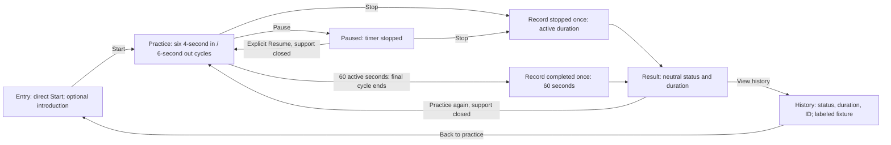
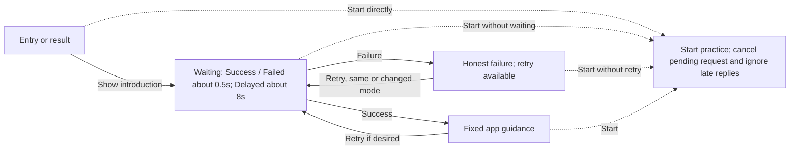
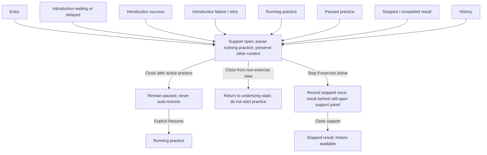

# Part 1 flow — initial design

**Initial design, not a completed Figma capture.** Coursework prototype; fictional scenarios only.

[View the complete SVG diagram](part1-flow.svg) · [PNG preview](part1-flow.png) · [Research rationale](../design-pipeline.md)

The SVG is the standalone visual; the Mermaid blocks below provide editable text versions of the same flow. They are grouped to avoid a web of crossing safety arrows.

## 1. Main practice flow

Pause and support time are excluded; entry/setup time is reported separately. The result remains until a person chooses another action. History is accessible after stopping or completing. The prototype can retain the result when returning from history; “entry” in the diagram denotes the practice view, not a mandatory reset or new session.

## 2. Optional mock introduction

The introduction is never required. Start (or Practice again from a result) and Crisis support remain available throughout these states. Loading prevents duplicate requests; changing modes invalidates the old response. The selected Failed mode keeps failing until the person changes mode; Retry does not imply automatic recovery. No real AI provider is involved. While support is open, Start is disabled until it is closed.

## 3. Universal crisis-support path

This is a global route, not a classifier decision or model-generated link. Opening support during practice pauses it. Resume stays disabled while support is open. Closing support leaves it paused; only an explicit Resume restarts timing. If a mock request finishes while support is open, it may update its underlying introduction state, but must not close support or start practice. Stop remains available within support whenever practice is active.

## Selected design direction versus current implementation

- **Selected, not implemented:** persistent bottom bar with Crisis support in every relevant state and Stop during running/paused practice; hide general navigation during practice and restore it on Stop/completion; optional “Remember my display choice.”
- **Confirmed design rule:** the system reduced-motion setting takes precedence over a saved animated preference. Persistence is future work; live OS-setting changes and associated wording require implementation checks.
- **Implemented baseline:** six cycles, pause/resume/stop, mock success/failure/delay with stale-response protection, independent support panel, temporary history, and still cue. The current support button scrolls with the page.
- **Current limitation:** history and preferences reset on refresh; the labeled fixture returns. No database, backend or live AI. Neither a persistent bar nor persistent preferences are claimed complete.

The figure communicates transitions and selected direction, not proof that every state, viewport, or accessibility behavior has passed a test. See [verification notes](../verification.md) for actual prior observations and diagram review.
